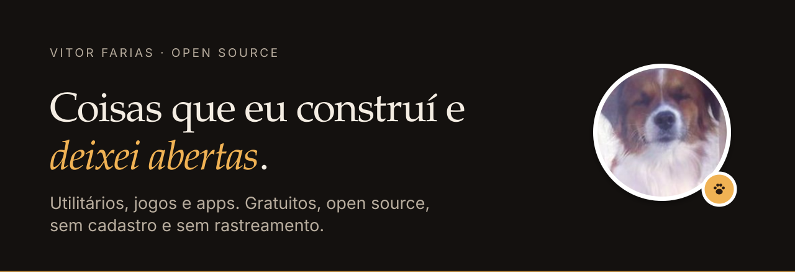
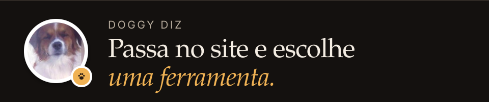

<picture>
  <source media="(prefers-color-scheme: dark)" srcset="assets/banner-dark.svg">
  <source media="(prefers-color-scheme: light)" srcset="assets/banner-light.svg">
  
</picture>

**Utilitários, jogos e apps do Vitor Farias.** Gratuitos, open source, sem cadastro e sem rastreamento.

  <a href="https://vitorfariasvf.github.io/VF-Tools/"><b>Ver ferramentas e repositórios →</b></a>
  &nbsp;·&nbsp;
  <a href="https://github.com/VitorFariasVF/VF-Tools">Código do site</a>

## Ferramentas

<b>1</b> PRONTA &nbsp;·&nbsp; <b>2</b> EM CONSTRUÇÃO

  <b>01</b> &nbsp;<b><a href="https://vitorfariasvf.github.io/cronometro-github-pages/">Cronômetro</a></b> 
  Cronômetro simples e rápido, direto no navegador. 
  UTILIDADES &nbsp;·&nbsp; <b>DISPONÍVEL</b> &nbsp;·&nbsp; # Web &nbsp;# JavaScript

  <b>02</b> &nbsp;<b><a href="https://github.com/VitorFariasVF/Ferramenta-de-backup-e-editor-de-save-r.e.p.o">Backup &amp; Editor de Save — R.E.P.O</a></b> 
  Faça backup e edite os saves do jogo R.E.P.O com segurança. 
  UTILIDADES &nbsp;·&nbsp; EM CONSTRUÇÃO &nbsp;·&nbsp; # Saves &nbsp;# Desktop

  <b>03</b> &nbsp;<b><a href="https://github.com/VitorFariasVF/dnd5e-builder">D&amp;D 5e Builder</a></b> 
  Monte fichas de personagem de D&amp;D 5e com escolhas guiadas. 
  CASUAL &nbsp;·&nbsp; EM CONSTRUÇÃO &nbsp;·&nbsp; # D&amp;D &nbsp;# Web

## Princípios

- **Gratuito e aberto.** Todo o código é público.
- **Sem cadastro e sem rastreamento.** O que as ferramentas guardam fica só no seu navegador.
- **Uma identidade só.** Todas seguem o mesmo [padrão de design](https://github.com/VitorFariasVF/VF-Tools/blob/Main/DESIGN.md).

<picture>
  <source media="(prefers-color-scheme: dark)" srcset="assets/footer-dark.svg">
  <source media="(prefers-color-scheme: light)" srcset="assets/footer-light.svg">
  
</picture>
